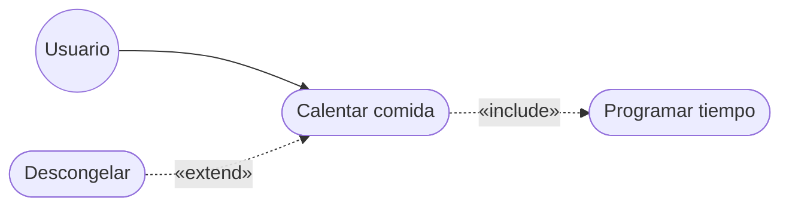
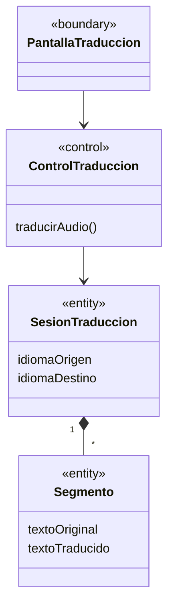
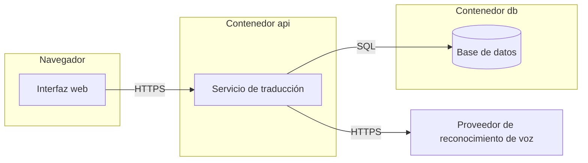
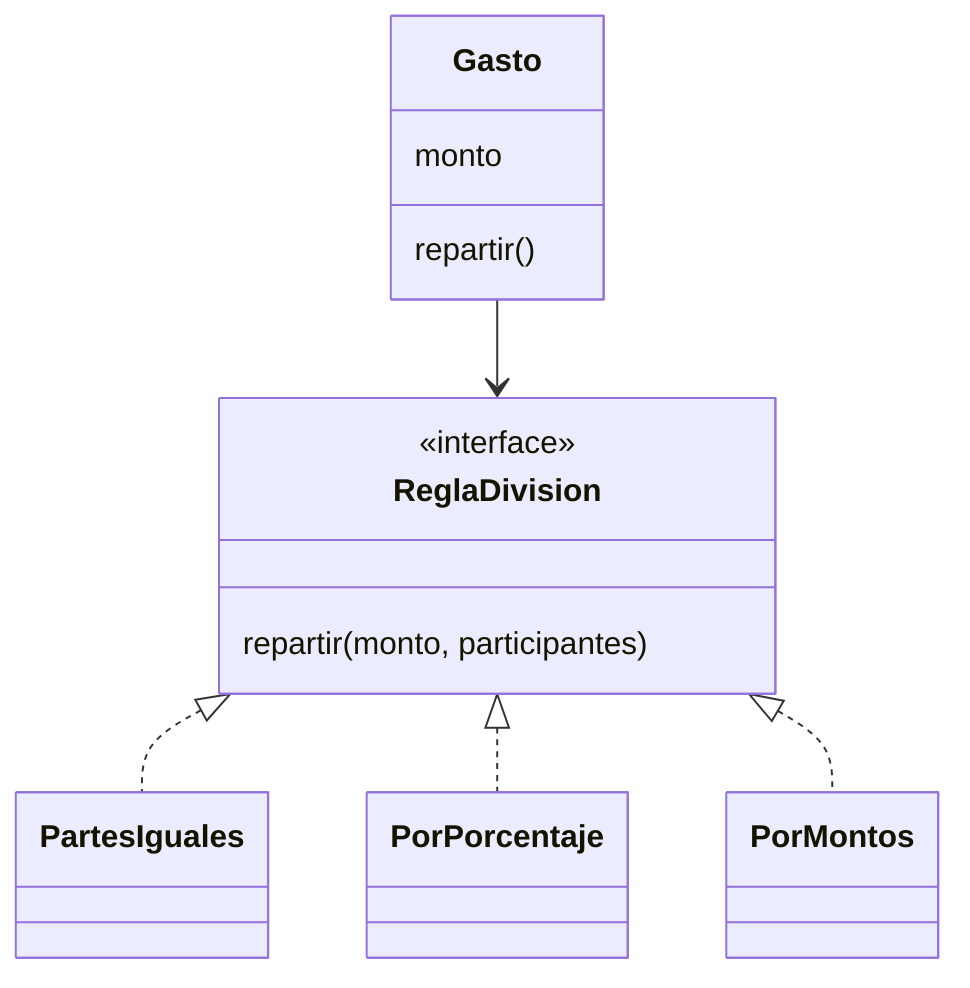
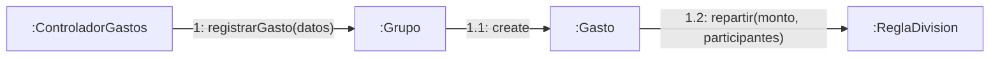
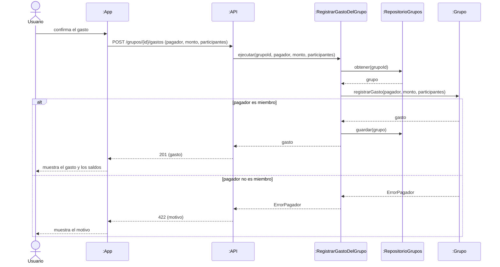
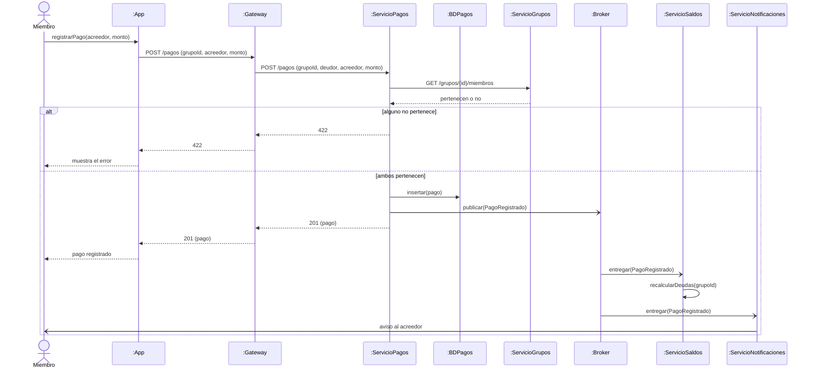
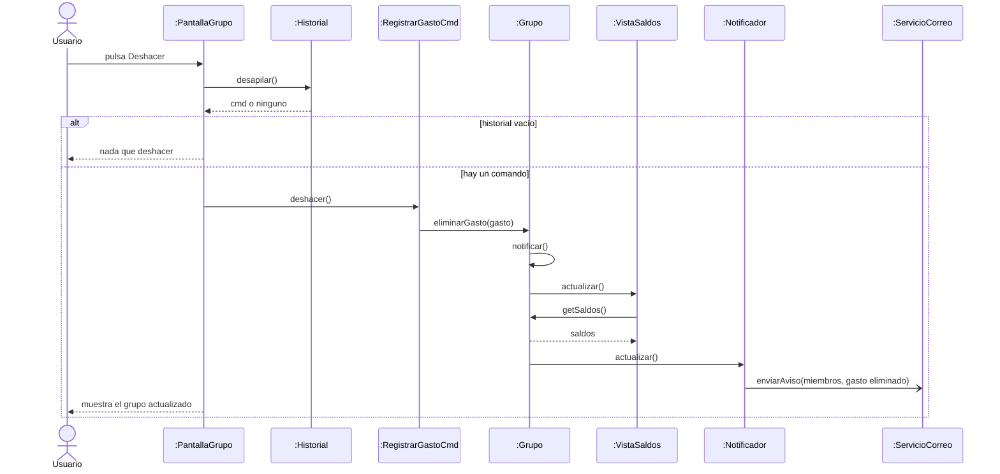

# CI-3715 · Contexto del curso (clases 1 a 11) para animaciones

Nov 23, 2026 · @Juan Andres

## Cómo usar este contexto

Este documento resume las clases 1 a 11 de CI-3715 Ingeniería de Software (Universidad Simón Bolívar) para que otra IA genere animaciones y ejemplos coherentes con lo que se enseñó. Todo el material está en español, para estudiantes de pregrado de computación. El curso va de SCRUM y requerimientos (clases 1 y 2) al modelo de análisis (3), el diseño del sistema (4), los patrones (5) y las responsabilidades y contratos (7). El tema central del segundo bloque, de la clase 8 en adelante, es el **diagrama de secuencia de diseño**: el que se pide en el segundo parcial a partir de dos párrafos de requerimientos.

**Qué se le pide a cada animación:** que muestre cómo avanza una petición mensaje por mensaje, de arriba hacia abajo, desde que el actor hace algo hasta que recibe la respuesta, y qué rama se toma en cada `alt`, `opt` o `loop`.

### Convenciones de notación (obligatorias)

| Elemento                  | Cómo se dibuja                                                                               | Ejemplo                                                 |
| ------------------------- | -------------------------------------------------------------------------------------------- | ------------------------------------------------------- |
| Actor                     | Muñeco con su rol debajo                                                                     | Usuario, Cliente, Coordinador                           |
| Objeto o componente       | Caja con `nombre:Clase` o `:Clase`                                                           | `:App`, `:API`, `:RegistrarGasto`, `:RepositorioGrupos` |
| Sistema externo           | Caja con el estereotipo `«sistema externo»` y fondo gris claro                               | `«sistema externo» :Pasarela`                           |
| Estereotipo de capa o rol | Texto en cursiva encima del nombre                                                           | `«presentación»`, `«productor»`, `«broker»`             |
| Línea de vida             | Línea punteada vertical bajo cada participante                                               | —                                                       |
| Mensaje síncrono          | Línea continua con **triángulo negro**                                                       | `registrar(monto, moneda)`                              |
| Mensaje asíncrono         | Línea continua con **triángulo de relleno blanco**; nunca tiene retorno                      | `publicar(GastoRegistrado)`                             |
| Retorno                   | Línea **punteada** con triángulo blanco; etiqueta en cursiva gris con el valor               | `saldo`, `ErrorMoneda`, `201 (gasto)`                   |
| Creación                  | Línea punteada con triángulo blanco hacia la caja del objeto nuevo, que aparece a esa altura | `«create» :Recibo`                                      |
| Mensaje a sí mismo        | Flecha que sale y vuelve a la misma línea de vida                                            | `validar(monto)`                                        |
| Fragmento                 | Recuadro con el operador en la esquina y la guarda entre corchetes                           | `alt [saldo suficiente]`, `else [saldo insuficiente]`   |
| Llamada HTTP              | `VERBO /ruta (datos)` y el retorno con código                                                | `POST /gastos (monto)` → `201 (gasto)`                  |
| Redirección               | Retorno `302 Location: url` al navegador y luego una **petición nueva del navegador**        | Nunca una flecha directa entre servidores               |

La punta blanca se usa desde la clase 9 para distinguir a simple vista; en la clase 8 se vio con punta abierta (la de UML estándar). En Mermaid, el asíncrono se escribe `-)` y el retorno `-->>`.

**Fragmentos:** `alt` (alternativas excluyentes, una por cada «si no» del texto), `opt` (algo que puede ocurrir o no, un «si» sin alternativa), `loop` («para cada», «hasta que»), `break` (corta el resto de la interacción), `ref` (remite a otra interacción dibujada aparte), `par` (ramas en paralelo).

### Estilo visual de las láminas del curso

- Paleta: fondo oscuro `#17252B`, texto `#1F2D33`, menta `#2FA37A` (y `#DDF2E9` claro), ámbar `#F2A541` (y `#FCEFD9` claro), gris `#5B6B70`, fondo claro `#F4F7F6`, rojo de error `#D9534F`.
- Tipografía: Cambria para títulos, Calibri para texto.
- Los diagramas van dibujados, nunca como código en pantalla.
- No se muestran puntajes de examen en las láminas.
- Ejemplo transversal: el proyecto **Cuentas Claras** (siguiente sección).

## El curso y el ejemplo transversal

**Curso:** CI-3715 Ingeniería de Software, Universidad Simón Bolívar. Teoría de 2 horas por clase, más una sesión práctica (sesión B) de ejercicios. El programa oficial incluye «diagramas de interacción: diagramas de secuencia de eventos del sistema y diagramas de comunicación; contratos». El libro base es Bruegge y Dutoit, _Object-Oriented Software Engineering Using UML, Patterns, and Java_, 3.ª edición.

**El segundo parcial** vale 15 puntos: 7 de selección simple (patrones, particionamiento, estilos e interfaces) y 8 de diagramas de secuencia dibujados a partir de dos párrafos de requerimientos. El nivel esperado es el de la documentación real de un inicio de sesión con OAuth o de un pago con redirecciones.

**Cuentas Claras** es el proyecto del curso y el ejemplo de casi todas las láminas: un asistente de finanzas personales multimoneda, _local-first_, con gastos compartidos.

- **La aplicación** (escritorio y Android) guarda en el dispositivo las cuentas y movimientos del usuario en varias monedas.
- **El servidor** (HTTP) solo guarda lo que otros necesitan ver: identidad, amistades, solicitudes entre usuarios y **grupos** con sus gastos compartidos y el balance de deudas, al estilo Splitwise.
- Vocabulario que aparece en los diagramas: cuenta, movimiento, gasto, grupo, miembro, pagador, saldo, deuda, tasa de cambio, moneda.
- Participantes típicos en las láminas: `Usuario`, `:App`, `:API`, `:RegistrarGasto` (caso de uso), `:Grupo` (dominio), `:RepositorioGrupos` (datos), `:Cuenta`, `«sistema externo» :ProveedorTasas`.

### Mapa del curso

| Clase    | Tema                                                             | Ejemplo que se usa                                         |
| -------- | ---------------------------------------------------------------- | ---------------------------------------------------------- |
| 1        | Ingeniería de software ágil y SCRUM                              | Traductor en tiempo real (proyecto de laboratorio)         |
| 2 y 2B   | Requerimientos; introducción a UML, escenarios y casos de uso    | Traductor; microondas; biblioteca                          |
| 3 y 3B   | Modelo de análisis: entidad, límite y control                    | Traductor (caso de uso TraducirAudio)                      |
| 4 y 4B   | Diseño del sistema: subsistemas, capas y estilos de arquitectura | Traductor; primer diseño de Cuentas Claras                 |
| 5 y 5B   | Diseño de objetos y patrones de diseño                           | Vehículos; Cuentas Claras                                  |
| 6        | Repaso del primer parcial                                        | Reservas de laboratorio; cafetería                         |
| 7 y 7B   | Responsabilidades (GRASP) y contratos                            | Cuentas Claras (registrar un gasto, aceptar una solicitud) |
| 8 y 8B   | Diagramas de secuencia de diseño                                 | Cuentas Claras                                             |
| 9 y 9B   | Particionamiento, estilos y sistemas distribuidos                | Cuentas Claras (saldar una deuda)                          |
| 10 y 10B | Patrones de comportamiento en diagramas de secuencia             | Cuentas Claras (deshacer un gasto)                         |
| 11       | Repaso del segundo parcial                                       | Preguntas tipo examen                                      |

Las clases 1 a 4 usan como ejemplo el traductor en tiempo real que los equipos construyen en el laboratorio. Desde la clase 4B el ejemplo pasa a ser Cuentas Claras y se mantiene hasta el final.

## Clase 1 — Ingeniería de software ágil y SCRUM

**Idea central:** el software es complejo y cambia mientras se construye. Por eso se trabaja con un proceso que entrega valor en ciclos cortos y aprende de cada uno.

**Conceptos:**

- Qué es la ingeniería de software: manejar la complejidad y el cambio. Diferencia entre el proceso (cómo se trabaja) y el producto (lo que se entrega).
- El Manifiesto Ágil: cuatro valores (individuos e interacciones, software que funciona, colaboración con el cliente, respuesta al cambio) y doce principios.
- SCRUM:
  - Roles: Product Owner (decide qué se construye y en qué orden), Scrum Master (cuida el proceso y quita impedimentos) y equipo de desarrollo.
  - Artefactos: Product Backlog, Sprint Backlog e incremento.
  - Eventos: Sprint Planning, Daily, Sprint Review y Retrospectiva, dentro de un sprint de duración fija.
- El proyecto de laboratorio: un traductor en tiempo real, 11 semanas, equipos de 4 a 5 personas, con un plan de entregas por sprint.

**Ideas para animar:**

- El sprint como una rueda que gira: Product Backlog → Planning → días de trabajo con Daily → incremento → Review → Retrospectiva → siguiente vuelta.
- Cascada contra iterativo: la misma obra entregada de una sola vez al final, contra incrementos pequeños que reciben retroalimentación y corrigen el rumbo.
- Una tarjeta del backlog que viaja de Product Backlog a Sprint Backlog, a "en curso" y a "hecho".

**Referencias:** Manifiesto Ágil (Beck y otros, 2001, agilemanifesto.org); Schwaber y Sutherland, _The Scrum Guide_ (2020); Bruegge y Dutoit, capítulos 1 y 16.

## Clase 2 — Requerimientos

**Idea central:** un requerimiento es una promesa sobre lo que el sistema hará. Si no se puede verificar, no sirve.

**Conceptos:**

- Actividades: obtención (elicitación) y análisis de requerimientos.
- Requerimientos funcionales (lo que el sistema hace) y no funcionales (cómo lo hace: desempeño, usabilidad, confiabilidad, seguridad, restricciones de implementación).
- Los siete criterios de validación: completo, consistente, no ambiguo, correcto, realista, verificable y trazable.
- Requerimientos en SCRUM: MVP, épica, historia de usuario y tarea. Formato de la historia: "Como ‹rol›, quiero ‹acción› para ‹beneficio›", con criterios de aceptación. Estimación con una escala de puntos y planning poker.

**Ideas para animar:**

- Un árbol que se abre: épica → historias de usuario → tareas.
- Planning poker: todos muestran su carta a la vez, se discuten los extremos y en la segunda ronda los valores convergen.
- Un requerimiento ambiguo ("la traducción debe ser rápida") que se reescribe paso a paso hasta ser verificable (con un tiempo máximo medible).

**Referencias:** Bruegge y Dutoit, capítulo 4 (_Requirements Elicitation_); Schwaber y Sutherland, _The Scrum Guide_ (2020).

### Clase 2B — Introducción a UML: escenarios y casos de uso

**Conceptos:**

- UML (estándar del OMG desde 1997) y sus vistas: funcional, de objetos y dinámica.
- Escenario: una ejecución concreta, con personas y datos concretos. Ejemplo de la clase: almuerzoRápido con un microondas.
- Caso de uso: la descripción general que cubre muchos escenarios. Se usa la plantilla de Bruegge: nombre, actores participantes, flujo de eventos, condiciones de entrada y de salida, y requerimientos de calidad.
- El mal ejemplo de la figura 4-9 del libro, para practicar cómo corregir un caso de uso.
- Diagrama de casos de uso: actores, generalización, «include», «extend» y paquetes.
- Actividad en clase: casos de uso de una biblioteca.

**Ideas para animar:**

- El escenario como una película de un caso concreto y el caso de uso como el guion que sirve para muchas películas.
- «include» y «extend» con flechas punteadas en sentidos opuestos: en «include» la flecha va del caso base al incluido (siempre ocurre); en «extend» va de la extensión al caso base (ocurre solo bajo una condición).

**Ejemplo (diagrama de casos de uso aproximado con un flowchart):**

**Referencias:** Bruegge y Dutoit, capítulo 2 (_Modeling with UML_) y capítulo 4 (figura 4-9; ejercicios 4-1 a 4-11).

## Clase 3 — Modelo de análisis

**Idea central:** el análisis describe el problema en el lenguaje del dominio, sin decidir todavía cómo se implementa.

**Conceptos:**

- Los tres modelos: funcional (casos de uso), de objetos (diagrama de clases) y dinámico (diagramas de secuencia y de estados).
- Tipos de objetos: entidad (información que persiste), límite (interacción con los actores) y control (coordina un caso de uso).
- Heurísticas de Abbott para pasar del texto a objetos: sustantivo propio → instancia; sustantivo común → clase; verbo de acción → operación; "es un" → herencia; "tiene" o "consta de" → agregación; adjetivo → atributo.
- Generalización y especialización; asociaciones con roles y multiplicidad; agregación contra composición; atributos.

**Ideas para animar:**

- El texto de un caso de uso con sustantivos y verbos que se resaltan y "vuelan" a convertirse en clases, atributos y operaciones.
- Los tres íconos (límite, control, entidad) y un mensaje que siempre entra por el límite, pasa por el control y llega a la entidad.
- Composición contra agregación: al borrar el todo, las partes compuestas desaparecen y las agregadas sobreviven.

### Clase 3B — Diagramas del modelo de análisis

Se dibujan en Mermaid los diagramas de clases, de secuencia de análisis y de estados del caso de uso TraducirAudio del traductor, y se revisan con una lista de verificación de calidad.

**Ejemplo (nombres ilustrativos):**

**Referencias:** Bruegge y Dutoit, capítulo 5 (_Analysis_), pp. 173–220, en especial 5.3.2 y 5.4.1 a 5.4.3; Abbott, "Program Design by Informal English Descriptions", _Communications of the ACM_ 26(11), 1983.

## Clase 4 — Diseño del sistema y estilos de arquitectura

**Idea central:** el diseño del sistema decide cómo se parte el sistema en subsistemas y cómo se comunican, guiado por los requerimientos no funcionales.

**Conceptos:**

- Análisis contra diseño: del qué al cómo.
- Objetivos de diseño, que salen de los requerimientos no funcionales.
- Subsistemas y servicios. Acoplamiento (dependencias entre subsistemas, se quiere bajo) y cohesión (relación dentro de un subsistema, se quiere alta).
- Capas y particiones. Una capa inferior no conoce a las superiores.
- Estilos: cliente-servidor, capas, SOA con ESB, microservicios, orientado a eventos, CQRS y hexagonal (puertos y adaptadores). El antipatrón espagueti como contraejemplo. Tabla comparativa de estilos.

**Ideas para animar:**

- Acoplamiento como hilos entre cajas: un sistema espagueti con hilos por todas partes que se reordena en pocas dependencias limpias.
- Una petición que baja capa por capa y la respuesta que sube, sin saltos hacia arriba.
- El hexágono: el dominio al centro, puertos en el borde y adaptadores que se cambian (una base de datos por otra) sin tocar el centro.

**Referencias:** Bruegge y Dutoit, capítulo 6 (_System Design: Decomposing the System_), pp. 223–258; como mínimo la sección 6.3, pp. 228–247.

### Clase 4B — Taller de diseño del sistema

**Conceptos:**

- Del análisis al diseño: entidad → objeto de dominio más repositorio; control → servicio de aplicación; límite → controlador o interfaz de usuario.
- Objetivos de diseño (tablas 6-2 a 6-6 del libro) y sus compromisos (por ejemplo, rapidez contra memoria, o costo de desarrollo contra mantenibilidad).
- Diagrama de componentes con interfaces provistas y requeridas.
- Primer diagrama de secuencia de diseño (traducir un audio).
- Diagrama de despliegue y su equivalente en docker-compose; estructura de carpetas por capa.
- Ejercicio: primer diseño de Cuentas Claras sobre dos de sus requerimientos (RF-COM-04 y RF-COM-10).

**Ejemplo (despliegue del traductor, ilustrativo):**

**Referencias:** Bruegge y Dutoit, capítulo 6 (tablas 6-2 a 6-6) y sección 7.3 (despliegue).

## Clase 5 — Diseño de objetos y patrones de diseño

**Idea central:** un patrón es una solución probada a un problema de diseño que se repite, con consecuencias conocidas.

**Conceptos:**

- Actividades del diseño de objetos y revisión de diseño.
- Bases de la programación orientada a objetos: clases y objetos, los cuatro principios (abstracción, encapsulamiento, herencia y polimorfismo) y modificadores de acceso. Ejemplo de la clase: una jerarquía de vehículos.
- Criterios para evaluar un patrón: problema que resuelve, solución y consecuencias.
- Catálogo GoF en tres familias: creacionales, estructurales y de comportamiento.
- Los patrones que usa Cuentas Claras:
  - Factory Method.
  - Adapter, como capa anticorrupción frente a servicios externos.
  - Composite.
  - Decorator, como caché sobre el proveedor de tasas de cambio.
  - Proxy, para la carga perezosa del historial.
  - Command, uno por cada caso de uso.
  - Observer: un gasto compartido genera un movimiento en el libro.
  - Strategy, para las reglas de división de un gasto.
  - State, para una solicitud pendiente, aceptada o rechazada.
- El Singleton se evita a propósito: el reloj y el generador de identificadores se inyectan como puertos.
- También se presentan Abstract Factory, Builder, Bridge, Facade, Iterator, Template Method y Visitor.

**Ideas para animar:**

- Cada patrón como un "antes y después": el código con un `if` por cada caso que se reemplaza por objetos intercambiables (Strategy).
- Decorator como capas que envuelven al objeto original: la llamada atraviesa la caché y solo llega al proveedor si no hay dato guardado.
- Composite como un árbol en el que una operación sobre la raíz se propaga a todas las hojas.
- Proxy como un sustituto que solo carga el historial real cuando alguien lo pide.

### Clase 5B — Taller de patrones sobre Cuentas Claras

Los equipos trabajan por rondas, cada una con un patrón aplicado a Cuentas Claras: Strategy (dividir un gasto), Decorator (tasas de cambio con caché), State (la solicitud) y Adapter u otra opción. Cada ronda se implementa en Rust con pruebas.

**Ejemplo:**

**Referencias:** Bruegge y Dutoit, capítulo 8 (_Object Design: Reusing Pattern Solutions_) y apéndice A (_Design Patterns_); Gamma, Helm, Johnson y Vlissides, _Design Patterns: Elements of Reusable Object-Oriented Software_ (1994).

## Clase 6 — Repaso del primer parcial

**Conceptos:**

- Formato del examen y un banco de preguntas tipo examen organizadas en seis bloques, cada una con su respuesta explicada.
- Un método paso a paso para la parte escrita.
- Ejercicio guiado: reservas de laboratorio.
- Simulacro: cafetería.

**Ideas para animar:**

- Una pregunta de selección en la que los distractores se descartan uno a uno, cada uno con la razón por la que es incorrecto.
- El método de la parte escrita como una lista de pasos que se va marcando sobre el ejercicio de reservas.

**Referencias:** los capítulos de las clases 2 a 5.

## Clase 7 — Responsabilidades y contratos

**Idea central:** antes de dibujar mensajes hay que decidir quién es responsable de qué, y qué promete cada operación.

**Conceptos:**

- Responsabilidades de conocer (datos propios, objetos relacionados) y de hacer (calcular, crear, coordinar).
- GRASP:
  - Experto en información: la responsabilidad va a quien tiene los datos.
  - Creador: crea un objeto quien lo contiene o lo usa de cerca.
  - Controlador: un objeto que recibe los eventos del sistema.
  - Bajo acoplamiento y alta cohesión.
- Diagramas de comunicación, con mensajes numerados (1, 1.1, 1.2).
- Contratos: invariante (siempre cierto), precondición (lo que debe cumplirse antes de llamar) y postcondición (lo que la operación garantiza al terminar). Ejemplo: Solicitud.aceptar.
- Liskov con contratos: una subclase no puede exigir más en la precondición ni prometer menos en la postcondición.
- Actividad: registrar un gasto en un grupo.

**Ideas para animar:**

- Una tabla de responsabilidades que se va llenando y, a la vez, el diagrama de comunicación que aparece mensaje por mensaje.
- Un contrato como un semáforo: si la precondición falla, la llamada se rechaza; si pasa, la operación corre y la postcondición se verifica al salir.
- Liskov como una balanza: la subclase puede aceptar más y prometer más, nunca al revés.

### Clase 7B — Taller de responsabilidades y contratos

Sobre Cuentas Claras: tabla de responsabilidades, diagrama de comunicación, contratos escritos en código Rust y una prueba por cada cláusula del contrato.

**Ejemplo (comunicación aproximada con un flowchart; nombres ilustrativos):**

**Referencias:** Bruegge y Dutoit, capítulo 9 (_Object Design: Specifying Interfaces_), pp. 349–392; el OCL formal queda fuera a propósito. Larman, _Applying UML and Patterns_, capítulos sobre GRASP.

## Clase 8 — Diagramas de secuencia de diseño e interfaces

**Idea central:** el diagrama de secuencia de diseño muestra cómo se comunican los componentes reales: qué operaciones se llaman, con qué parámetros, qué devuelven, cómo llama el actor y cómo recibe la respuesta, y qué pasa en ciclos y excepciones. **Cada mensaje es una operación del receptor.**

**Contenidos:**

1. **Análisis frente a diseño.** La secuencia de análisis usa límite, control y entidad con mensajes del dominio; la de diseño usa la app, el API, el caso de uso, el repositorio y los servicios externos, con firmas y retornos.
2. **Notación completa:** participantes, activación, tipos de mensaje, parámetros y retornos, fragmentos `alt`, `opt`, `loop`, `break`, `ref`, etapas.
3. **Interfaces:** un componente provee interfaces (bola) y requiere otras (semicírculo). Un mensaje que cruza de un componente a otro es una operación de la interfaz que provee el receptor. En la arquitectura hexagonal, el puerto es la interfaz y el adaptador la implementa.
4. **Cuatro reglas de consistencia con el diagrama de clases y los contratos:** cada mensaje existe como operación del receptor; los parámetros alcanzan y el retorno trae lo necesario; cada precondición que puede fallar tiene su `alt` o `break`; un objeto solo llama a objetos que conoce (asociación, parámetro o creación).
5. **Ciclo de vida de una petición:** usuario → app → API → caso de uso → repositorio y dominio → y de vuelta hasta el actor.
6. **Método en siete pasos:** leer y marcar, participantes, etapas, camino feliz, parámetros y retornos, excepciones (`alt`/`break`), ciclos y opcionales (`loop`/`opt`), revisión de consistencia.
7. **Errores frecuentes:** mensajes sin parámetros ni retorno; el actor hablando con una entidad o la base de datos; llamar a un objeto desconocido; retornos con línea continua; excepciones que no aparecen; una sola línea de vida llamada «Sistema»; el actor sin respuesta.

**Ejemplo principal para animar — registrar un gasto de grupo:**

**Otros ejemplos de la clase:** registrar un movimiento con `alt` por moneda distinta (`ErrorMoneda`); dividir un gasto con `loop` por miembro y `opt` para notificar; la actividad «Pedir bicicleta» (dos `alt` anidados: penalización vigente y bicicleta no disponible, y una llamada a un servicio externo de candados para desbloquear).

## Clase 8B — Secuencias I: del caso de uso al diseño

Tres ejercicios de dificultad creciente, cada uno con enunciado, solución dibujada y qué se corrige:

| Ejercicio                                      | Qué practica                                                                                                                                         | Participantes                                                                                                            |
| ---------------------------------------------- | ---------------------------------------------------------------------------------------------------------------------------------------------------- | ------------------------------------------------------------------------------------------------------------------------ |
| Retiro en un cajero automático                 | Dos `alt` anidados (credenciales inválidas, saldo insuficiente) y un `opt` (comprobante)                                                             | Cliente, :Cajero, «sistema externo» :ServidorBanco, :Cuenta                                                              |
| Profesor reserva un laboratorio para una clase | `alt` (ocupado o libre) y `loop` que cancela reservas de estudiantes con aviso por correo asíncrono                                                  | Profesor, :AppWeb, :API, :ReservarParaClase, :RepositorioReservas, «sistema externo» :ServicioCorreo                     |
| Pedidos de la cafetería (dos párrafos)         | Dos etapas y dos actores: hacer el pedido (`loop` de disponibilidad, `alt` de saldo) y marcarlo listo (`alt` cancelado, notificación push asíncrona) | Cliente, Personal de cocina, :App, :PanelCocina, :API, :HacerPedido, :MarcarListo, repositorios, :ServicioNotificaciones |

Tarea: inscripción de materias (un `loop` con `alt` y `opt` de lista de espera dentro).

**Rúbrica de corrección** (la misma del parcial): participantes; mensajes con parámetros; ciclo de vida completo hasta el actor; cada «si no» como `alt` o `break`; «para cada» como `loop` y «si» sin alternativa como `opt`; asíncronos sin retorno; consistencia con el diagrama de clases.

## Clase 9 — Particionamiento y estilos de arquitectura en secuencia

**Idea central:** la arquitectura decide quiénes son los participantes del diagrama y qué tipo de mensajes se cruzan. Antes de dibujar hay que saber cómo está particionado el sistema.

**Particionamiento:**

- **Capa:** grupo de subsistemas que ofrece servicios a la capa de arriba usando solo las de abajo. **Arquitectura cerrada:** cada capa usa solo la inmediata inferior; **abierta:** puede saltar capas hacia abajo. Nunca se llama hacia arriba; solo los retornos suben.
- **Partición:** subsistemas pares, uno por funcionalidad (Gastos, Grupos, Notificaciones).
- **Por capa o por componente funcional:** carpetas `presentacion/ logica/ datos/` frente a `gastos/ grupos/ notificaciones/`. Por capa, cambiar una tecnología queda en un lugar; por componente, cambiar una funcionalidad completa queda en un lugar.
- Heurística del libro: 7 ± 2 subsistemas por nivel. Acoplamiento bajo y cohesión alta.
- **Interfaces entre particiones:** el mensaje usa el nombre y los parámetros de la interfaz provista; nadie llama a un objeto interno de otra partición ni a su base de datos.

**Estilos y su huella en la secuencia (cada uno tiene un diagrama en las láminas):**

| Estilo               | Participantes                                                                  | Mensajes                                                          | Qué se revisa                                                                                                                    |
| -------------------- | ------------------------------------------------------------------------------ | ----------------------------------------------------------------- | -------------------------------------------------------------------------------------------------------------------------------- |
| Capas                | Uno por capa, con estereotipo «presentación», «aplicación», «dominio», «datos» | Síncronos hacia abajo                                             | Que no salte capas ni llame hacia arriba                                                                                         |
| Cliente-servidor     | «cliente», «servidor»                                                          | Petición y respuesta                                              | Que inicie el cliente; el servidor no conoce clientes                                                                            |
| MVC                  | Controlador, modelo, vistas                                                    | Las vistas se suscriben; el modelo les notifica y ellas consultan | Que el modelo no dependa de una vista concreta                                                                                   |
| MVVM                 | Vista, ViewModel, modelo                                                       | Enlace (binding) y «propiedad cambiada»                           | Que el ViewModel no llame a la vista                                                                                             |
| Repositorio          | Subsistemas y un repositorio central                                           | Todo pasa por el repositorio                                      | Que los subsistemas no se hablen; riesgo de cuello de botella                                                                    |
| Microservicios       | Gateway, servicios, una base de datos por servicio                             | Llamadas por red con `alt` por si el otro no responde             | **Aislamiento del almacenamiento** (nadie toca la BD de otro) e **independencia de procesos** (cada servicio falla por separado) |
| Dirigido por eventos | «productor», «broker», «consumidor»                                            | Asíncronos sin retorno                                            | Que el productor no espere ni conozca a los consumidores                                                                         |

**Ejemplo para animar — eventos (liquidar una deuda):**

Punto clave para animar: la respuesta 201 sale **antes** de que los consumidores terminen.

## Clase 9B — Secuencias II: sistemas distribuidos

**Notación de lo distribuido:** el navegador es un participante aparte; una **redirección** es un `302` al navegador y una petición nueva del navegador; los **secretos y tokens** solo viajan de servidor a servidor; un **webhook** es una petición nueva que inicia el sistema externo; un **evento** es asíncrono hacia el broker.

| Ejercicio                                                                      | Qué muestra                                                                                                                                                                                                                                                                                             |
| ------------------------------------------------------------------------------ | ------------------------------------------------------------------------------------------------------------------------------------------------------------------------------------------------------------------------------------------------------------------------------------------------------- |
| Iniciar sesión con la cuenta USB (flujo tipo OAuth con código de autorización) | Etapa 1: redirección al servidor de autorización, inicio de sesión, consentimiento (`alt` credenciales incorrectas, `alt` no autoriza). Etapa 2: el servidor de la app cambia el código por un token enviando su secreto, pide el perfil al servidor de recursos y crea la cuenta si no existe (`opt`). |
| Pagar una entrada con una pasarela                                             | Etapa 1: orden pendiente, sesión de pago, redirección a la pasarela, autorización del banco (`alt` rechazado/aprobado). Etapa 2: **webhook** firmado de la pasarela; solo ahí se marca la orden como pagada; correo asíncrono. La tienda nunca ve la tarjeta.                                           |
| Cierre de mes con eventos                                                      | `loop` por grupo que publica PeriodoCerrado; el servicio de reportes lo consume, genera un PDF y publica ResumenGenerado; notificaciones consume ese segundo evento y envía correos con `opt` a una cola de reintentos si el proveedor rechaza uno.                                                     |

Tarea: recuperar la contraseña (respuesta idéntica exista o no la cuenta, token con vencimiento, correo asíncrono, `alt` anidados al restablecer).

## Clase 10 — Patrones de comportamiento en secuencia

**Idea central:** los patrones ya se vieron en la clase 5 por su diagrama de clases; aquí se ven por **quién llama a quién y en qué orden**. Cada patrón deja una huella reconocible en la secuencia. Para no confundirlos: pregunten quién decide.

| Patrón                  | Problema                                                                      | Huella en la secuencia                                                                                                             | Ejemplo en Cuentas Claras                                                                                |
| ----------------------- | ----------------------------------------------------------------------------- | ---------------------------------------------------------------------------------------------------------------------------------- | -------------------------------------------------------------------------------------------------------- |
| Observer                | Varios objetos deben enterarse de un cambio sin que el publicador los conozca | `suscribir` al inicio; tras el cambio, `actualizar()` a cada suscriptor por una interfaz; el suscriptor consulta el estado         | `:Grupo` publica; `:VistaSaldos` y `:NotificadorCorreo` se actualizan                                    |
| Command                 | Guardar, deshacer o encolar una petición                                      | `«create»` del comando, `ejecutar()` desde el invocador, el comando llama al receptor, `apilar(cmd)` en el historial; `deshacer()` | `:BotonGuardar`, `:RegistrarGastoCmd`, `:Grupo`, `:Historial`                                            |
| Chain of Responsibility | Varios objetos pueden atender o rechazar una petición                         | El mismo mensaje `manejar(solicitud)` pasa de eslabón en eslabón; cada uno puede cortar con un `alt`                               | `:ValidarMonto` → `:ValidarMiembros` → `:ValidarMoneda`                                                  |
| Mediator                | Muchos objetos se coordinan y quedan todos conectados                         | Estrella: los colegas solo hablan con el mediador, que decide a quién llamar                                                       | `:CampoMonto` avisa a `:FormularioGasto`, que recalcula `:ListaParticipantes` y habilita `:BotonGuardar` |
| State                   | El comportamiento cambia según el estado y el código se llena de `if`         | El contexto delega en su estado actual; el estado crea el siguiente (`«create»`) y se lo asigna al contexto                        | `:Deuda` con estados `:Pendiente` y `:Saldada`                                                           |

Distinciones clave: Observer frente a Mediator (el publicador no decide; el mediador sí). State frente a Strategy (en Strategy el cliente elige el algoritmo; en State lo decide el estado). Command frente a Strategy (el comando se guarda y se deshace). Chain frente a Decorator (cualquier eslabón corta la cadena).

**Ejercicio de la clase — deshacer un gasto (Command + Observer):** la pantalla pide al historial el último comando (`alt` historial vacío); el comando le pide al grupo eliminar el gasto; el grupo notifica a la vista de saldos (que consulta los saldos) y al notificador (que envía un correo asíncrono).

## Clase 10B — Secuencias III: al nivel del parcial

Dos ejercicios individuales de dos párrafos, 40 minutos cada uno, con corrección cruzada y rúbrica:

| Ejercicio                          | Qué combina                                                                                                                                                                                                                                                                                                                                                                                                                                           |
| ---------------------------------- | ----------------------------------------------------------------------------------------------------------------------------------------------------------------------------------------------------------------------------------------------------------------------------------------------------------------------------------------------------------------------------------------------------------------------------------------------------- |
| Pedir un viaje compartido          | Etapa 1: cotizar con un servicio de mapas externo (`alt` no responde) y reservar el cobro en la pasarela (`alt` tarjeta rechazada); publicar ViajeSolicitado y responder sin esperar. Etapa 2: el servicio de asignación ofrece el viaje a cada conductor por cercanía hasta que uno acepte (`loop` con vencimiento de 15 s); `alt` aceptado (ViajeAsignado, aviso al pasajero) o ninguno (ViajeSinConductor, el servidor de viajes libera el cobro). |
| Reembolso con aprobación en cadena | Etapa 1: subir la foto del recibo, pedir lectura a un servicio externo que responde con un **callback** (`alt` no pudo leer). Etapa 2: Chain of Responsibility por monto (supervisor ≤ 100, gerente ≤ 1.000, director); la decisión del aprobador; `alt` rechazada (correo) o aprobada (evento ReembolsoAprobado que consume nómina).                                                                                                                 |

**Errores que más restan:** flecha directa entre servidores donde hay una redirección; secreto o token por el navegador; publicar con retorno o esperando al consumidor; leer la BD de otro servicio; «si no» sin `alt` o `alt` sin guarda; `loop` sin condición de salida; una rama sin respuesta al actor; mensajes sin parámetros o que no están en la interfaz.

## Clase 11 — Repaso para el segundo parcial

Clase teórica de repaso, sin sesión B. Se muestran preguntas del tipo del parcial, se vota y se explica por qué la correcta lo es y las otras no.

**Parte 1 — 24 preguntas de selección en seis bloques:**

1. **Patrones de la clase 5:** Decorator (caché sin modificar la clase), Builder, Composite y cuándo conviene aplicar un patrón.
2. **Patrones de comportamiento:** reconocer un Mediator en una figura de secuencia; Strategy frente a State; qué mensaje no debe aparecer en un Observer; Command para operaciones sin conexión.
3. **Particionamiento y estilos:** por capa para cambiar la base de datos; cómo se entera la vista en MVVM; desventaja del repositorio; independencia de procesos en microservicios.
4. **Interfaces:** una interfaz requerida que nadie provee; qué debe tener un retorno según la firma; el puerto en la arquitectura hexagonal; reemplazar una implementación por otra.
5. **Notación de secuencia:** punta blanca sin retorno (asíncrono); `opt` dentro de `loop`; `break`; `ref`.
6. **Sistemas distribuidos:** por dónde viaja el código de autorización; cómo se dibuja un webhook; por qué la tienda no marca pagada la orden en la página de confirmación; dónde va el 201 tras publicar un evento.

**Parte 2 — Diagramas de secuencia:**

- **Método en siete pasos** y una tabla para traducir el texto: persona → actor; sistema que no construimos → «sistema externo»; «si no» → `alt` o `break`; «para cada», «hasta que» → `loop`; «si» sin alternativa → `opt`; «sin esperar», «publica» → asíncrono; «redirige» → 302 al navegador y petición nueva; «más tarde, … notifica» → webhook.
- **Ejercicio guiado — comprar boletos de cine:** etapa 1, bloquear asientos 10 minutos (`alt` alguno ocupado), crear sesión de pago y redirigir; etapa 2, webhook de la pasarela (`alt` aprobado: confirmar, generar boletos con QR, publicar CompraConfirmada que consume el servicio de correo; rechazado: liberar asientos).
- **Simulacro en clase — retiro de una materia:** etapa 1, el estudiante pide el retiro (`alt` fuera del período; `alt` anidado si quedaría bajo el mínimo de créditos: pendiente de coordinador, o retiro y evento MateriaRetirada); etapa 2, el coordinador decide en un `loop` por solicitud (`alt` aprueba o rechaza), y los servicios de cupos y notificaciones consumen el evento.

**Consejos para el examen:** leer los dos párrafos y marcarlos antes de dibujar; primero participantes y camino feliz, las excepciones al final; cada «si no» es un `alt` y cada «sin esperar» un asíncrono; en selección, descartar primero las falsas; dejar minutos para revisar con la lista de errores.

## Referencias

**Libro base:** Bernd Bruegge y Allen H. Dutoit, _Object-Oriented Software Engineering Using UML, Patterns, and Java_, 3.ª ed., Prentice Hall, 2010.

| Tema                                                                                       | Sección                 | Páginas                | Clase |
| ------------------------------------------------------------------------------------------ | ----------------------- | ---------------------- | ----- |
| Introducción: qué es la ingeniería de software                                             | Capítulo 1              | —                      | 1     |
| Metodologías (incluye Scrum)                                                               | Capítulo 16             | —                      | 1     |
| UML: vistas y diagramas                                                                    | Capítulo 2              | —                      | 2B    |
| Obtención de requerimientos; casos de uso; mal ejemplo (Figura 4-9); ejercicios 4-1 a 4-11 | Capítulo 4              | —                      | 2, 2B |
| Modelo de análisis: entidad, límite y control; heurísticas de Abbott                       | 5.3.2 y 5.4.1 a 5.4.3   | 173–220 (177, 180–185) | 3, 3B |
| Diseño del sistema: subsistemas, capas y estilos                                           | Capítulo 6 (mínimo 6.3) | 223–258 (228–247)      | 4     |
| Objetivos de diseño y compromisos                                                          | Tablas 6-2 a 6-6        | —                      | 4B    |
| Diagrama de despliegue                                                                     | 7.3                     | —                      | 4B    |
| Reutilización con patrones de diseño                                                       | Capítulo 8 y apéndice A | —                      | 5, 5B |
| Especificar interfaces: contratos (sin OCL formal)                                         | Capítulo 9              | 349–392                | 7, 7B |
| Diagramas de interacción: notación, `alt` y `loop` (Figuras 2-34 y 2-35)                   | 2.2.3 y 2.4.3           | 32, 59–62              | 8     |
| De casos de uso a objetos con diagramas de secuencia                                       | 5.4.4                   | 185                    | 8     |
| Caso ARENA: secuencias en etapas (Figuras 5-26 a 5-28)                                     | 5.6.4                   | 213–214                | 8     |
| Servicios e interfaces de subsistemas                                                      | 6.3.2                   | 230                    | 8, 9  |
| Acoplamiento y cohesión; heurística 7 ± 2                                                  | 6.3.3                   | 230–234                | 9     |
| Capas y particiones; arquitectura abierta y cerrada                                        | 6.3.4                   | 235–238                | 9     |
| Estilos: repositorio, MVC (Figura 6-17), cliente-servidor                                  | 6.3.5                   | 238–243                | 9     |
| Adapter                                                                                    | 8.4.2                   | 323                    | 5, 11 |
| Command                                                                                    | 8.4.5 y 8.6.2           | 329, 342               | 10    |
| Identificar operaciones con una secuencia de diseño (Figura 9-10); firmas                  | 9.4.1 y 9.4.2           | 366–368                | 8     |
| Observer                                                                                   | Apéndice A.7            | 716                    | 9, 10 |
| Proxy                                                                                      | Apéndice A.8            | 717                    | 5, 11 |
| Definición de diagrama de secuencia (análisis frente a diseño de objetos)                  | Apéndice B, glosario    | 745                    | 8     |

**Otras fuentes:**

- Erich Gamma, Richard Helm, Ralph Johnson y John Vlissides, _Design Patterns: Elements of Reusable Object-Oriented Software_, Addison-Wesley, 1994. Fuente de Chain of Responsibility, Mediator y State, que el libro base no trata (clase 10), y del catálogo de la clase 5.
- Object Management Group, _Unified Modeling Language (UML) 2.5.1_, 2017, capítulo de interacciones. Notación completa de fragmentos combinados (`opt`, `break`, `ref`, `par`), que el libro base menciona de forma breve.
- IETF, _RFC 6749: The OAuth 2.0 Authorization Framework_, 2012, sección 4.1 (_Authorization Code Grant_). Base del ejercicio de inicio de sesión con un proveedor externo (9B) y de las preguntas de redirecciones.
- Craig Larman, _Applying UML and Patterns_, 3.ª ed., Prentice Hall, 2005, citado por el libro base. Lectura complementaria sobre diagramas de interacción con objetos de diseño.
- Microservicios, arquitectura dirigida por eventos, MVVM, webhooks y pasarelas de pago con redirección: se presentaron como complemento, fuera del libro base, sin una fuente única.
- Documentos del proyecto del curso: _Cuentas Claras — Especificación de Requerimientos_ y _Cuentas Claras — Contexto Completo_.

Fuentes adicionales para las clases 1 a 7:

- Beck y otros, _Manifiesto por el Desarrollo Ágil de Software_ (2001), agilemanifesto.org. Clase 1.
- Schwaber y Sutherland, _The Scrum Guide_ (2020), scrumguides.org. Clases 1 y 2.
- Abbott, "Program Design by Informal English Descriptions", _Communications of the ACM_ 26(11), 1983. Clase 3.
- Gamma, Helm, Johnson y Vlissides, _Design Patterns: Elements of Reusable Object-Oriented Software_ (1994). Clase 5.
- Larman, _Applying UML and Patterns_, capítulos sobre GRASP (segundo libro del programa). Clase 7.

**Materiales de clase:**

| Clase | Guía                                                                | Láminas                                             |
| ----- | ------------------------------------------------------------------- | --------------------------------------------------- |
| 1     | [Guía clase 1](https://claude.ai/artifact/2x4uvbggjVsaB3tJa6jhdd)   | CI-3715\_Clase1\_Agiles\_SCRUM.pptx                 |
| 2     | [Guía clase 2](https://claude.ai/artifact/VDMtmfKa4QuWoHMDt88RCj)   | CI-3715\_Clase2\_Requerimientos.pptx                |
| 2B    | [Guía clase 2B](https://claude.ai/artifact/XvMStX6quJsGwh2YQi66Th)  | CI-3715\_Clase2B\_Intro\_UML\_Casos\_de\_Uso.pptx   |
| 3     | [Guía clase 3](https://claude.ai/artifact/9KikoNNbKKdk4ufNmq41Z8)   | CI-3715\_Clase3\_Modelo\_Analisis\_Diseno.pptx      |
| 3B    | [Guía clase 3B](https://claude.ai/artifact/5o8k5NVdBFxaCU9zb26ZtU)  | CI-3715\_Clase3B\_Taller\_Diagramas.pptx            |
| 4     | [Guía clase 4](https://claude.ai/artifact/M2RX526xuTPgg8PDCQXv8n)   | CI-3715\_Clase4\_Diseno.pptx                        |
| 4B    | [Guía clase 4B](https://claude.ai/artifact/8znRRjDbeJrGWc2yemecjf)  | CI-3715\_Clase4B\_Taller\_Diseno.pptx               |
| 5     | [Guía clase 5](https://claude.ai/artifact/5i3u3YnfGodpozAjRxukJV)   | CI-3715\_Clase5\_Diseno\_Patrones.pptx              |
| 5B    | [Guía clase 5B](https://claude.ai/artifact/86myd4ggbcTxyNNTnDHXLT)  | CI-3715\_Clase5B\_Taller\_Patrones.pptx             |
| 6     | [Guía clase 6](https://claude.ai/artifact/CpywawBMJttjxWgr1ZXGGB)   | CI-3715\_Clase6\_Repaso\_Examen.pptx                |
| 7     | [Guía clase 7](https://claude.ai/artifact/8cZtRSZm5eBYw9oXugt2Ej)   | CI-3715\_Clase7\_Responsabilidades\_Contratos.pptx  |
| 7B    | [Guía clase 7B](https://claude.ai/artifact/6h2ZKTemSQcjJ8Yg2w4u4b)  | CI-3715\_Clase7B\_Taller\_Contratos.pptx            |
| 8     | [Guía clase 8](https://claude.ai/artifact/Kw51NqFN8CMKiMWunGeMJ5)   | CI-3715\_Clase8\_Diagramas\_de\_Secuencia.pptx      |
| 8B    | [Guía clase 8B](https://claude.ai/artifact/GMFWEKYWYwSvsyuqwsy95A)  | CI-3715\_Clase8B\_Secuencias\_I.pptx                |
| 9     | [Guía clase 9](https://claude.ai/artifact/16y4pwv6ZF3DQhdXLBk7v5)   | CI-3715\_Clase9\_Particionamiento\_y\_Estilos.pptx  |
| 9B    | [Guía clase 9B](https://claude.ai/artifact/Si4fFZQVdU1vCifHuzUWof)  | CI-3715\_Clase9B\_Secuencias\_II.pptx               |
| 10    | [Guía clase 10](https://claude.ai/artifact/G81Uo8kSBdL7dBrCPDjcqL)  | CI-3715\_Clase10\_Patrones\_de\_Comportamiento.pptx |
| 10B   | [Guía clase 10B](https://claude.ai/artifact/Pfxx1ADnbuWfwBGghE2fKG) | CI-3715\_Clase10B\_Secuencias\_III.pptx             |
| 11    | [Guía clase 11](https://claude.ai/artifact/DFH8gMUE9permC7vzcHYLV)  | CI-3715\_Clase11\_Repaso\_Parcial2.pptx             |
